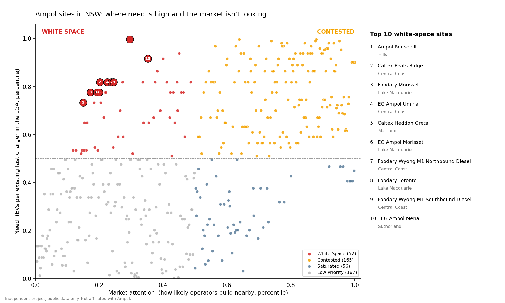

# Where should AmpCharge build its next EV chargers in NSW?


An independent data project looking at where Ampol's existing NSW service
stations could take an AmpCharge fast charger, and what actually drives where
the charging industry builds. Public data only.

**Independent project. Not affiliated with or endorsed by Ampol or AmpCharge.**

**[View the live interactive map »](https://ankur794.github.io/ampcharge-nsw/outputs/ampcharge_map.html)**

## The short version

The charging market clusters. New fast chargers are going in next to existing
ones and close to the city, not where EV owners are short of charging.

Scoring every Ampol site on **need** (EVs per existing fast charger) against
**market attention** (how likely operators are to build nearby) finds 48
"white space" sites: high need, little market interest. 15 of the top 20 sit in
one corridor, the **Central Coast, Lake Macquarie and Maitland**, along the M1
between Sydney and Newcastle. The top site is **Rouse Hill**: The Hills has
about **1,500 EVs per existing fast charger**, the highest in NSW.



This project is a **first-pass filter**: it narrows 539 Ampol sites down to a
shortlist worth a closer look. It is not a final build list, because the things
that really decide a site (grid capacity, lease terms, land cost) aren't public.

## The data

- **539 Ampol sites** in NSW (FuelCheck)
- **~3,400 charger records** from the official NSW EV charging register,
  including **94 planned fast chargers** not yet built
- **160,000+ battery EVs** across 128 council areas (LGAs), with 12-month growth

## What I tested, and what came out

I ran three tests and report all of them, including the ones that didn't go
the model's way.

**1. Does EV demand explain where fast chargers exist today?**
Across 128 LGAs, EV numbers line up with charger numbers (correlation 0.70,
cross-validated R² 0.45). But most of that is size: LGA size alone gives
R² 0.42, and EV demand adds only +0.07 on top. Per head, there's no clear link
(correlation -0.01). So bigger areas have more EVs and more chargers, but
demand alone doesn't explain placement.

**2. Are the planned chargers going into the gaps?**
No. Under-served LGAs are getting 43% of planned fast chargers, below the 52%
you'd expect from their EV numbers. The top-ranked Ampol opportunity sites
have a planned charger nearby 12% of the time, against 16% for other Ampol sites.

**3. So what does predict where the planned chargers go?**
I modelled it across all 539 Ampol sites (cross-validated AUC):

| What the model used | AUC |
| --- | --- |
| Distance to existing chargers and to the CBD | **0.74** |
| EV demand in the area | 0.66 |
| Site features (major road, Foodary) | 0.58 |

The plain-English version:

| Nearest existing fast charger | Ampol sites | Planned charger within 2 km |
| --- | --- | --- |
| under 1 km | 165 | **24%** |
| 1 to 3 km | 150 | 20% |
| 3 to 10 km | 93 | 9% |
| over 10 km | 131 | 4% |

A site next to an existing charger is about six times more likely to get a new
one nearby than a site more than 10 km away. Part of this is simply that busy
urban areas attract everything, but the clustering is clear.

## What it means

Two readings, and public data can't settle which is right:

1. The gaps exist for reasons we can't see from outside (grid capacity, land,
   leases), and operators are avoiding them for good reason.
2. The gaps are real and the market is leaving them open, which would be an
   opening for a company that already owns sites there.

Either way, the shortlist below is where it's worth asking that question.

## The white space

Each Ampol site gets two scores, kept deliberately separate:

- **Need:** EVs per existing fast charger in the site's LGA. Demand side only.
- **Market attention:** the probability of a planned fast charger nearby, from
  the proximity model in test 3, scored out-of-fold so no site is scored by a
  model that saw it, and averaged over 50 different random splits. Market side
  only.

Splitting each at the median gives four groups (440 sites with LGA data):

| Group | Sites | Planned charger within 2 km | Has a Foodary |
| --- | --- | --- | --- |
| Contested (high need, high attention) | 164 | 26% | 48% |
| **White space (high need, low attention)** | **53** (48 outside border areas) | **11%** | 36% |
| Saturated (low need, high attention) | 57 | 23% | 42% |
| Low priority (low need, low attention) | 166 | 8% | 28% |

Need and attention are positively related (rank correlation 0.56): for the
most part the market does go where need is. The white space is the exceptions.

**How stable is it?** Re-running the attention model with 50 different random
splits, 46 of the 48 white-space sites (border areas excluded) land in the
white space in at least 80% of runs. Only 2 are borderline. Every site in the
top 20 holds up in 90% or more of runs. The `white_space_freq` column in the
output gives the share for each site.

**Top 10 white-space sites:**

| # | Site | LGA | EVs per fast charger |
| --- | --- | --- | --- |
| 1 | Ampol Rouse Hill | The Hills | 1,496 |
| 2 | Caltex Peats Ridge | Central Coast | 706 |
| 3 | EG Ampol Morisset | Lake Macquarie | 666 |
| 4 | Ampol Foodary Morisset | Lake Macquarie | 666 |
| 5 | EG Ampol Umina | Central Coast | 706 |
| 6 | Ampol Foodary Wyong M1 (southbound) | Central Coast | 706 |
| 7 | Caltex Heddon Greta | Maitland | 601 |
| 8 | Ampol Foodary Toronto | Lake Macquarie | 666 |
| 9 | Ampol Brunkerville | Maitland | 601 |
| 10 | Ampol Foodary Wyong M1 (northbound) | Central Coast | 706 |

All ten are white space in 100% of the 50 runs.

Full ranking: `outputs/white_space_sites.csv` (column `white_space_rank`).
The top 20 are numbered on the map.

**Two clean-ups before ranking:**

- FuelCheck lists some sites twice (separate petrol and diesel entries), so
  entries within 100 m, or within 1 km with the same name, were merged:
  539 entries became 530 physical sites.
- Sites in council areas on the ACT, QLD, VIC or SA border are left out of the
  ranking, because chargers across the state line aren't in the NSW register.
  Five white-space sites around Queanbeyan, next to Canberra, were set aside
  for this reason.

## Limitations

- EV numbers are only available by LGA, so anything finer is an estimate.
- Planned chargers have no LGA in the source file, so each was given the LGA of
  its nearest existing charger.
- 94 planned chargers is a small sample; treat test 2 as a signal, not proof.
- Need is measured per LGA, so every site in the same LGA shares a need score;
  within an LGA the ranking is driven by market attention.
- Site postcodes are parsed from FuelCheck addresses, which occasionally picks
  up the wrong number and puts a site in the wrong LGA.
- No grid, land or cost data, so this finds candidates, not decisions.

## Run it

```bash
pip install -r requirements.txt

# check the scoring engine on synthetic data with a known answer
PYTHONPATH=src python -m pytest tests/ -q

# with the public data files in data/raw/
PYTHONPATH=src python scripts/validate_demand.py        # test 1 + shortlist
PYTHONPATH=src python scripts/backtest_upcoming.py      # test 2
PYTHONPATH=src python scripts/what_drives_placement.py  # test 3
PYTHONPATH=src python scripts/white_space.py            # need vs attention + chart
PYTHONPATH=src python scripts/build_map.py              # the map
```

## Data sources

- Ampol sites: NSW FuelCheck (from my fuel-price project)
- Charger locations: [NSW EV Charging Locations](https://data.nsw.gov.au/data/dataset/2-ev-charging-locations)
- EV registrations by LGA: NSW vehicle registration data (Peclet open data portal)
- Postcode and LGA lookup: [australianpostcodes](https://github.com/matthewproctor/australianpostcodes)

## Layout

```
src/ampcharge/   scoring engine and shared helpers (geo.py: distances,
                 LGA name matching, charger ratings, de-duplication)
scripts/         fetch, test and map scripts
tests/           unit tests and synthetic ground-truth tests (run with pytest)
data/raw/        downloaded public data (not committed)
outputs/         map, shortlist and test results
```
